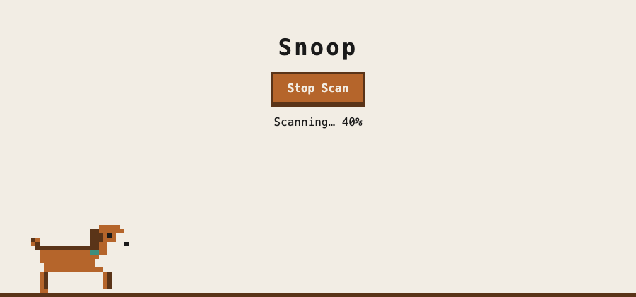

# SNOOP 🐕

Sniffing out object oriented protocols.

Snoop is a pixel-art dog who runs back and forth while a scan is going and sits and wags when it's done. Plain HTML, CSS and JavaScript.

He still needs some training but the thought is he will be able to be dropped into any codebase, provide an overlay visual of him sniffing; and be able to tell you where you can make some augments to your codebase.



## Run locally

```bash
open index.html
```

For demo mode, where Snoop runs forever and takes a 2-second sit between laps, serve the folder:

```bash
python3 -m http.server 8000
open "http://localhost:8000/?demo"
```

Or let Snoop run across your terminal (Ctrl+C to stop):

```bash
node scripts/terminal-run.js
```

More quick checks are in [TRY-IT.md](TRY-IT.md).

## Development

- `sprite.js`: Snoop as 24×16 character grids, drawn at 6× scale. There's a 4-frame run cycle and a 2-frame sit-and-wag. Five-color palette: fawn, dark brown, white, black, teal collar.
- `main.js`: the canvas loop, movement (2 px per frame), the Start/Stop Scan toggle, and a placeholder `scan()` that fakes progress.
- `style.css`: layout, plus `image-rendering: pixelated` so every sprite pixel stays crisp.
- [SPEC.md](SPEC.md): the v1 plan, covering the `snoop` CLI, its rules, the JSON output, the tests and the v1–v3 roadmap.
